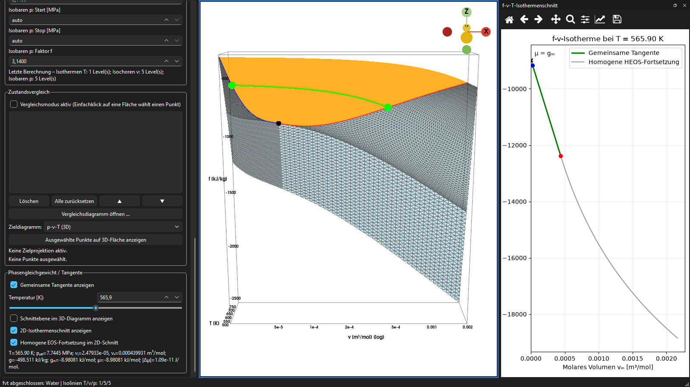

# Interaktive gemeinsame Tangente im f-v-T-Diagramm

## Thermodynamischer Zusammenhang

Für eine reine Substanz im unterkritischen Flüssigkeit-Dampf-Gleichgewicht gilt bei einer Temperatur `T`:

```text
f_m(v) = f_m,l - p_sat (v - v_l)
      = μ - p_sat v
μ = f_m,l + p_sat v_l = g_m,l = g_m,v
```

`f_m` und `g_m` bezeichnen molare Helmholtz- und Gibbs-Energie [J/mol], `v` ist das molare Volumen [m³/mol] und `p_sat` der HEOS-Sättigungsdruck [Pa]. Die unabhängige Tangentenprüfung ist `(f_m,v - f_m,l) / (v_v - v_l) = -p_sat`. CoolProp liefert massenspezifische Energien; sie werden für diese Rechnung mit der molaren Masse in kg/mol multipliziert.

Die Zustände werden mit `AbstractState("HEOS", fluid)` und `QT_INPUTS` bei `Q=0` und `Q=1` bestimmt. `fvt_tangent.calculate_fvt_tangent()` weist Temperaturen außerhalb des offenen unterkritischen Bereichs, ungültige HEOS-Ergebnisse und inkonsistente Potentiale ausdrücklich zurück. Die Ergebnisstruktur enthält die massen- und molarbezogenen Sättigungswerte, chemisches Potential, Tangentenpunkte und numerische Validierungsabweichungen. Die Linie zwischen den Sättigungszuständen wird im 3D-Renderer **zuerst in physikalischen Koordinaten erzeugt** und danach über `to_xyz_fvt` transformiert; daher wird die logarithmische Volumenachse nicht für die thermodynamische Steigung missbraucht. Die physikalischen Volumenpunkte sind logarithmisch verteilt, damit die transformierte Polylinie auch nahe dem Flüssigkeitspunkt die Tangente genau annähert.

## Bedienung

Die Gruppe **Phasengleichgewicht / Tangente** wird angezeigt, wenn ein berechnetes f-v-T-Diagramm aktiv ist. Checkbox und Temperaturfeld/Schieberegler zeigen bzw. ändern die Tangente und beide Sättigungsmarker, ohne die Zustandsfläche neu zu berechnen. Änderungen des Schiebereglers werden 130 ms entprellt. Die Anzeige nennt Temperatur, Sättigungsdruck, beide molaren Volumina, massenspezifische und molare Gibbs-Energie, chemisches Potential und `|Δμ|`.

**Schnittebene im 3D-Diagramm anzeigen** legt eine nicht-pickbare Ebene bei `T/Tc` über den aktuellen Plotterbereich. **2D-Isothermenschnitt anzeigen** öffnet ein dockbares, nicht-modales Fenster. Die linearen 2D-Achsen zeigen die gemeinsame Tangente, Sättigungsendpunkte und deren mathematischen Achsenabschnitt bei `v=0`, explizit mit `μ = gₘ` beschriftet. Der Achsenabschnitt ist eine Extrapolation und kein Zustand mit Nullvolumen. Die Werkzeugleiste bietet Zoom und die Rückkehr zur Gesamtansicht. Wenn aktiviert, ergänzt das Panel getrennte, tatsächlich mit HEOS ausgewertete homogene Kurven außerhalb des Zweiphasenintervalls; fehlende Werte unterbrechen die Kurven. Die Abtastung läuft im Hintergrund; überholte Ergebnisse werden verworfen. Fehler werden in der Statusleiste angezeigt.

Overlay-Actoren sind nicht pickbar und werden bei Temperaturänderung ersetzt, nicht angesammelt. Das 3D-Update ruft weder `clear()` noch `reset_camera()` auf. Der 2D-Plot verwendet lineare Achsen, damit Steigung und Achsenabschnitt der gemeinsamen Tangente direkt lesbar sind.



## Numerische Tests

`test_fvt_tangent.py` vergleicht Wasser, CO₂ und R134a mit direkten HEOS-Sättigungszuständen und prüft Druck, Volumina, Gleichheit der molaren Gibbs-Energien, Tangentensteigung und Achsenabschnitt. Weitere Tests prüfen ungültige Temperaturen, molare/massenspezifische Darstellungsumrechnung und die getrennten homogenen EOS-Zweige.

Eine zusätzliche numerische Stichprobe mit Wasser, CO₂ und R134a bei jeweils fünf Temperaturen zwischen `Tmin + 0,25 (Tc - Tmin)` und `Tmin + 0,999 (Tc - Tmin)` ergab einen maximalen relativen Druckfehler von `8,34e-13` und eine maximale Potentialdifferenz von `3,50e-10 J/mol`. Die Implementierung begrenzt den relativen Druckfehler auf `1e-8`; für Potentialdifferenzen gilt die Toleranz `max(1e-4 J/mol, |μ| · 1e-8, R · T · 1e-7)`.

Die Abbildung zeigt eine auf diesem Windows-System aufgenommene Ansicht für Wasser bei 565,9 K. Eine visuelle Freigabe auf unterschiedlichen Windows-GPU-Treibern, DPI-Skalierungen und Bildschirmgrößen ist **noch nicht erfolgt**.

