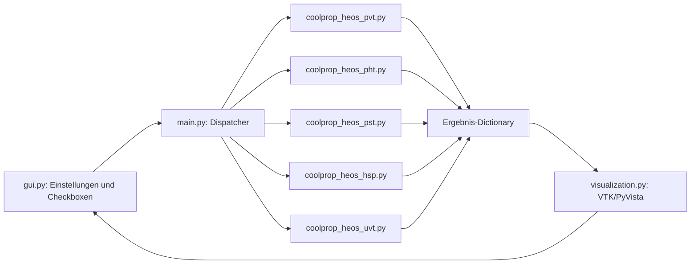

# ThermoSurface: Interaktive dreidimensionale Visualisierung thermodynamischer Zustandsflächen

**Wissenschaftlicher Arbeitsbericht zur Studienarbeit Chemie und Verfahrenstechnik**  
**Bearbeitungsstand:** 19. Oktober 2026  
**Programmstand:** AP1–AP4 (Bestand) und Implementierungen für AP5–AP10  
**Validierungskennzeichnung:** Der numerische Vergleich mit realen HEOS-Läufen und die GUI-Abnahme sind in der vorliegenden Ausführungsumgebung *nicht abgeschlossen*. Diese wissenschaftliche Dokumentation trennt analytisch belegte Aussagen, ausgeführte softwaretechnische Tests und ausstehende thermodynamische Messungen ausdrücklich.

## Zusammenfassung

Die Anwendung ThermoSurface wurde entwickelt, um die Zustandsoberflächen reiner Fluide in fünf unterschiedlichen thermodynamischen Koordinatensystemen interaktiv darzustellen. Die Berechnung nutzt das CoolProp-Backend HEOS, die Netzgeometrie PyVista/VTK und die Benutzeroberfläche PySide6 mit PyVistaQt. Die vorliegenden Diagrammtypen sind p-v-T, p-h-T, p-s-T, h-s-p und u-v-T. In den Datenmodulen werden die Sättigungsgrenzen, gemischte Zustände im Nassdampfgebiet und der kritische Punkt explizit behandelt. Im p-v-T-Diagramm kommen gesonderte Spinodalkurven hinzu. Ziel des Ausbauabschnitts ist die Ergänzung der p-h-T-Isolinien, eine externe Referenzvalidierung, ein wissenschaftlich beschränkter vdW-Vergleich und eine Untersuchung der Interpolationskonvergenz.

In der vorliegenden Bearbeitungsumgebung konnten synthetische und analytische Programmtests ausgeführt werden. Der Nachweis für die HEOS-Ergebnisse gegen IAPWS-IF97, die Laufzeitmessungen sowie der Echtbetrieb der grafischen Oberflächen bleiben dem Zielrechner vorbehalten. Daher ist die wissenschaftliche Ergebnislage zum Bearbeitungsstand noch nicht vollständig.

## 1. Einleitung und Fragestellung

Klassische zweidimensionale Zustandsdiagramme projizieren jeweils zwei Größen auf die Zeichenebene. Eine dreidimensionale Darstellung kann zusätzliche Abhängigkeiten verdeutlichen und den Zusammenhang zwischen Zustandsflächen, Isolinien und Koexistenzgrenzen untersuchbar machen. Die komplexe Form einer realen Fluid-Zustandsfläche erfordert zugleich eine sorgfältige Unterscheidung zwischen homogenem Zustand und thermodynamischem Phasengleichgewicht. Die Zielsetzung dieser Studienarbeit lautet, die Berechnungs- und Darstellungsarchitektur zu entwickeln beziehungsweise zu überprüfen und nachweisbar zuverlässige numerische Verfahren zur Geometrieerzeugung und Darstellung einzusetzen.

Die fachlichen Untersuchungsfragen sind: (1) Können Phasengrenzen und Zustandsflächen mit *identischen* Randknoten erzeugt werden? (2) Stimmen modellberechnete Werte an festgelegten Zuständen mit geeigneten unabhängigen Referenzformulierungen überein? (3) Welche Grenzen hat eine einfache kubische Zustandsgleichung im Vergleich mit einer hochentwickelten Helmholtz-EOS? (4) Wie verändert sich der geometrische Interpolationsfehler bei zunehmender Netzdichte?

## 2. Thermodynamische Grundlagen

### 2.1 Thermische und kalorische Zustandsgrößen

Eine thermische Zustandsgleichung verknüpft Druck, Temperatur und Volumen beziehungsweise Dichte. Kalorische Größen wie die spezifische Enthalpie `h`, die spezifische Entropie `s` und die innere Energie `u` sind mit dem thermischen Zustand verknüpft. Im Projekt gilt durchgängig die Basis `T [K]`, `p [Pa]`, `v_m [m³/mol]`, `h,u [J/kg]` und `s [J/(kg K)]`. Das molare Volumen ist `v_m = 1/rho_molar`; mit der molaren Masse `M [kg/mol]` ist das massenspezifische Volumen `v_mass = v_m/M`.

Die Nullpunkte von `h`, `s` und `u` sind von der Referenzzustandsfestlegung abhängig. Negative absolute Zahlen in einer definierten Referenzkonvention sind nicht automatisch physikalisch unzulässig. Um die relevanten Größen bei stark unterschiedlichen Stoffen grafisch handhabbar zu halten, transformiert die Visualisierung die Koordinaten. Im p-v-T-Diagramm werden beispielsweise `x = log10(v_m/v_mc)`, `y = T/Tc`, `z = log10(p/pc)` verwendet. Folglich sind ausschließlich positive Drücke und Volumina darstellbar; die ursprünglichen SI-Werte bleiben in den Berechnungsdaten erhalten.

### 2.2 HEOS als Referenzmodell

CoolProp HEOS wertet stoffabhängige thermodynamische Referenzgleichungen in einer Zustandsformulierung auf Grundlage der Helmholtz-Energie aus. Die verwendete `AbstractState`-Instanz erlaubt wiederholte Zustandseinstellungen mit `DmolarT_INPUTS`, `PT_INPUTS` oder Sättigungsbedingungen `QT_INPUTS`. Bei der Interpretation ist zwischen bibliotheksinternen Modellwerten und unabhängigen Messdaten zu unterscheiden. HEOS-Ausgaben gegen einen zweiten HEOS-Aufruf sind Selbstkonsistenzprüfungen und *keine* externe Stoffdatenvalidierung.

### 2.3 Phasengleichgewicht und Zweiphasenfläche

Für einen Reinstoff im Dampf-Flüssig-Gleichgewicht gelten bei gegebener Sättigungstemperatur `T` die Sättigungsdrücke der Flüssigkeit und des Dampfs als identisch. Die Siede- und Taulinien besitzen dieselben Temperatur-/Druckkoordinaten, aber verschiedene Sättigungsvolumina und kalorische Größen. Für einen Dampfgehalt `Q` zwischen 0 und 1 gelten bei Gleichgewicht die massenbezogenen Mischungsbeziehungen

`v_mass = (1-Q) v_l,mass + Q v_g,mass`,  
`h = (1-Q) h_l + Q h_g`,  
`s = (1-Q) s_l + Q s_g`,  
`u = (1-Q) u_l + Q u_g`.

Beim molaren Volumen ist dieselbe Formel für den Reinstoff anwendbar, weil eine einheitliche molare Masse vorliegt. Die Näherung besteht nicht in der thermodynamischen Mischungsformel, sondern in der diskreten Abtastung der Q-Koordinate und der Verbindung der Punkte zu einem Visualisierungsnetz. Am kritischen Punkt verschwindet die Differenz der Sättigungszustände. Die geometrische Behandlung der dadurch entarteten Q-Zeile ist deshalb ein eigenständiges numerisches Problem.

Die im p-v-T-Diagramm getrennt dargestellte Spinodale betrifft die Stabilitätsgrenze homogener Phasen mit `(∂p/∂v)_T = 0`. Ein metastabiler homogener Zustand liegt zwischen Binodale und Spinodale; eine mechanisch instabile homogene Isotherme weist lokal `(∂p/∂v)_T > 0` auf. Das Vorliegen einer Spinodalkurve bedeutet *nicht*, dass die Gleichgewichts-Zustandsfläche metastabile oder instabile Zustände vollständig darstellt.

### 2.4 Clausius–Clapeyron-Beziehung

Für den Phasenübergang erster Ordnung gilt am Sättigungszustand

`dp_sat/dT = (h_g-h_l) / [T (v_g,mass-v_l,mass)]`.

Der Druckgradient kann durch eine zentrale Differenz `[(p_sat(T+ΔT)-p_sat(T-ΔT))/(2ΔT)]` angenähert werden. Der Nenner erfordert *massenspezifische* Sättigungsvolumina, wenn die Enthalpie in `J/kg` eingesetzt wird. Eine Ableitungsprüfung aus zwei HEOS-basierten Rechenwegen kann Implementierungsfehler aufdecken, ist allerdings keine unabhängige experimentelle Stoffdatenvalidierung. Genau deshalb ergänzt AP6 die Rechnung um IAPWS-IF97-Vergleichstabellen.

### 2.5 Van-der-Waals-Zustandsgleichung

Die molare vdW-Gleichung hat die Gestalt `p = R T/(v_m-b)-a/v_m²`. Mit `a = 27 R² Tc² / (64 pc)` und `b = R Tc/(8 pc)` ergeben sich das kritische Modellvolumen `vc,vdW = 3 b` und `Zc,vdW = pc vc,vdW/(R Tc) = 3/8 = 0,375`. Diese Bedingung folgt algebraisch aus dem Wendepunkt der kritischen vdW-Isotherme. Die einfachen Parameter garantieren *nicht*, dass das kritische Volumen beziehungsweise der Kompressibilitätsfaktor eines realen Fluids richtig reproduziert wird.

Bei Verwendung der veröffentlichten IAPWS-Wasserparameter `Tc = 647,096 K`, `pc = 22,064 MPa`, `rho_c = 322 kg/m³` und `M = 0,018015268 kg/mol` ergeben sich für das Modell `b ≈ 3,0481 × 10⁻⁵ m³/mol`, `vc,vdW ≈ 9,1443 × 10⁻⁵ m³/mol`. Aus denselben Referenzgrößen folgt für Wasser `vc ≈ 5,5948 × 10⁻⁵ m³/mol` und `Zc ≈ 0,22944`. Die Differenz `0,375` gegen `0,22944` ist eine **analytische Aussage über die vereinfachte Modellstruktur**, kein gemessener Druckfehler einer HEOS-Vergleichsreihe.


*Abbildung 1: Aus `ap9_figure.py` analytisch erzeugte reduzierte vdW-Isothermen. Die subkritische Schleife ist ausdrücklich **nicht** als Gleichgewichts-Zweiphasenfläche zu interpretieren. Die Grafik basiert allein auf der angegebenen vdW-Gleichung und enthält keine HEOS-Messwerte.*

## 3. Numerische Methodik

### 3.1 Randkonforme Flächennetzgeometrie

Die Zustandsflächen werden diskretisiert und im Bereich unterhalb `Tc` in Flüssigkeits- und Dampfteilnetze getrennt. Für das p-v-T-Diagramm ist ausschlaggebend, dass die Sättigungstemperaturen ein Teil des tatsächlich verwendeten Flächenrasters sind und die Sättigungsvolumina an jeder betroffenen Temperaturzeile als explizite Randknoten eingebunden werden. Erst die **Identität** der Randkoordinaten gewährleistet eine exakt gemeinsame geometrische Phasengrenze. Eine bloße Verdichtung eines äquidistanten Volumenrasters erzeugt diese Identität im Allgemeinen nicht.

Der AP4-Validator verlangt identische Randknoten bei Q = 0 und Q = 1, korrekte Arrayformen, sinnvolle kritische Anschlüsse und positive thermische Größen. In der GUI wird die Einphasenfläche unabhängig von der Zweiphasenfläche geschaltet.

### 3.2 Berechnung der fünf Diagrammtypen

- **p-v-T:** Punkte `(T, v_m, p)`, separate Spinodaläste und Phasenmaske. Die stabile Fläche ist nicht automatisch eine vollständige homogene Fortsetzung in die mechanisch instabile Region.
- **p-h-T:** Punkte `(T, h, p)`, drei randkonforme Teilflächen, Zweiphasenflächen und ab AP5 separate Isothermen, Isobaren und Isochoren.
- **p-s-T:** Analoges Netz mit `s` statt `h`. Referenzabhängige negative `s`-Werte sind zulässig.
- **h-s-p:** Zusammenführung der p-h-T- und p-s-T-Daten durch Identität von `(T,p)`. Der aktuelle Ansatz berechnet teilweise dieselben HEOS-Zustände doppelt.
- **u-v-T:** `(T,v_m,u)` mit kalorienbezogener Q-Mischung, getrennten Phasengrenzen und ausgewählten Isolinien.

Die Grenzen der Auswertungsmodelle und die Menge gültiger Zustandseingaben können sich je nach Fluid unterscheiden. Nicht auswertbare Zustands- beziehungsweise Darstellungspunkte dürfen nicht durch unbegründete Extrapolation ersetzt werden.

### 3.3 Externe Validierung gegen IAPWS-IF97

Das Modul `ap6_reference.py` enthält feststehende, überprüfte Werte aus den offiziellen IAPWS-IF97-Tabellen 5, 15 und 35: fünf Einphasen-Zustandspunkte mit `v`, `h`, `s`, `u`, drei Sättigungsdrücke sowie die IAPWS-Kritikaldaten. Die IF97-Formulierung ist eine eigenständige industrielle Näherung an IAPWS-95 und damit eine geeignete **Formulierungs-Gegenprüfung**, jedoch nicht gleichbedeutend mit vollständig unabhängigen experimentellen Messungen. Ausgegeben werden absolute und relative Fehler. Als vorläufiges algorithmisches Akzeptanzkriterium wird eine relative Abweichung von 0,5 % für Tabelleneigenschaften und `10⁻⁵` für kritische Konstanten verwendet. Diese numerischen Prüfgrenzen sind keine aus der IAPWS-Veröffentlichung übernommene generelle Messunsicherheit.

Die Vergleichswerte werden aus einem frischen HEOS-`AbstractState` berechnet; bei fehlender Bibliothek wird kein Ergebnis erzeugt. Die vorhandene Clapeyron-Prüfung enthält drei Sättigungstemperaturen und vergleicht den numerischen Druckgradienten mit der thermodynamischen Gleichung, ebenfalls mit vorläufig 0,5 % relativer Toleranz.

### 3.4 vdW-HEOS-Modellvergleich

`ap7_vdw_compare.py` verwendet identische molare `(T,v)`-Zustände. Unterkritische Vergleichspunkte liegen ausschließlich auf der stabilen Dampfseite oberhalb des mit HEOS ermittelten Sättigungsvolumens. Oberhalb der kritischen Temperatur werden gasähnliche einphasige Zustände gewählt. Das unterkritische Gleichgewichts-Zweiphasenplateau wird **nicht** mit der unmodifizierten vdW-Schleife gleichgesetzt. Eine Maxwell-Konstruktion ist nicht Teil der Analyse. Die Auswertung liefert relative und absolute Druckabweichungen und den Unterschied der kritischen Kompressibilitätsfaktoren.

### 3.5 Konvergenzuntersuchung

`ap8_convergence.py` untersucht einen vorab definierten, einphasigen überkritischen Teilbereich: `1,07 Tc ≤ T ≤ 1,25 Tc` und `2 vc ≤ v_m ≤ 8 vc`. Drei Netzauflösungen `21 × 41`, `41 × 81` und `81 × 161` werden verglichen. Die Vergleichspunkte werden nach einem festen Zufallsstartwert innerhalb des Gebietes gewählt und mit separaten HEOS-Auswertungen bestimmt. Der Fehler ist die relative Abweichung einer *bilinear interpolierten* Druckfläche von diesen Kontrollwerten, nicht der Unterschied zweier auf identischen Knoten direkt berechneter Drücke. Erfasst werden Dauer pro Raster, Rasterarraybytes sowie optional die beobachtete Prozess-RSS nach dem Berechnungsdurchlauf. Die RSS-Messung ist **keine präzise Peak-RSS-Speicherprofilerfassung**. Eine Zielabweichung von `10⁻³` dient als ausdrücklich gewähltes Auswahlkriterium, nicht als pauschale ingenieurtechnische Garantie.

Die Messung umfasst ausschließlich diesen HEOS-T-v-Teilbereich und nicht GUI-Renderzeit, Spinodalen, Zweiphasenfläche oder einen vollständigen ThermoSurface-Durchlauf. Daraus kann keine allgemeine optimale Standardauflösung für *alle* Diagrammtypen abgeleitet werden.

## 4. Softwarearchitektur

Die Trennung der thermodynamischen Berechnung von der Darstellung ist eine wesentliche Entwurfsentscheidung. Die GUI (`gui.py`) ruft über `main.py` die jeweils ausgewählte Berechnungsroutine auf, ohne schon durch einen Diagrammwechsel sämtliche anderen Diagramme neu zu berechnen. Das Ergebnis ist ein Dictionary mit zentralen Feldern für Oberflächen, Phasengrenzen, kritischen Punkt und verfügbare Isolinien. Der Renderer (`visualization.py`) liest diese Daten, transformiert die SI-Koordinaten und erzeugt grafische VTK-Actor-Gruppen. Isolinien können ohne erneute Zustandsberechnung ausgeblendet werden.



Die analytische und numerische Studienauswertung liegt bewusst außerhalb der GUI in `ap6_reference.py`, `ap7_vdw_compare.py`, `ap8_convergence.py`. Dadurch wird das produktive HEOS-Modell nicht stillschweigend gegen vdW ausgetauscht und die Erweiterung kann auch ohne VTK-Grafik getestet werden.

## 5. Ergebnisse und nachgewiesener Stand

### 5.1 Technischer Nachweis

Ausgeführt wurden Syntaxprüfungen der mitgelieferten Python-Dateien sowie ein isolierter Unit-Testlauf mit 23 erfolgreichen synthetischen und analytischen Tests (AP1-Regressionstestlogik, AP4-Synthetik, AP5-Renderer-Mock und Isolinien-Schnittstelle, AP6-Daten-/Fehlerlogik, AP7-kritische vdW-Identitäten, AP8-Interpolation). Damit sind ausgewählte Codepfade und logische Bedingungen nachgewiesen. Es handelt sich **nicht** um 23 unabhängige experimentelle Stoffdatensätze und auch nicht um einen abgeschlossenen Gesamtfunktionstest.

Für den externen Referenzvergleich stehen die drei offiziellen IAPWS-IF97-Sättigungsdrücke `p_sat(300 K)=3.536,58941 Pa`, `p_sat(500 K)=2.638.897,76 Pa` und `p_sat(600 K)=12.344.314,6 Pa` bereit. Das sind **Literaturwerte**, nicht hier gemessene oder mit HEOS ausgewertete Vergleichsergebnisse. Für die von `ap6_reference.py` generierten Fehlerkennzahlen gibt es in dieser Ausführungsumgebung noch keine HEOS-Ausgabedatei.

### 5.2 Noch nicht gemessene Ergebnisgrößen

Die quantitative Referenzfehlertabelle für HEOS, tatsächliche Druckfehler des vdW-Modells sowie die Rechenzeit-/Interpolationstabelle und die ressourcenbezogene Rasterempfehlung sind **noch nicht ermittelt**, weil die notwendigen HEOS-Bibliotheken hier nicht verfügbar sind. Gleiches gilt für den realen GUI-/VTK-Endtest. Diese Lücke darf in einer finalen Studienarbeit nicht als bestanden oder wissenschaftlich abgesichert ausgewiesen werden.

### 5.3 Analytisches Modellergebnis

Der kritische Kompressibilitätsfaktor der vdW-EOS beträgt exakt `3/8`. Der Vergleich mit den veröffentlichten kritischen Wasserdaten führt auf `Zc,Wasser ≈ 0,22944`. Die Abweichung zeigt ohne iterative Zustandssuche eine intrinsische strukturelle Grenze der universellen vdW-Gleichung. Aussagen über die Druckabweichungen an ausgewählten homogenen Zuständen erfordern dagegen die noch ausstehenden HEOS-Rechenläufe.

## 6. Diskussion und methodische Grenzen

Für die Visualisierungsqualität sind exakte Übergänge zwischen separat triangulierten Phasenbereichen oft wichtiger als eine große Gesamtzahl von Rasterpunkten. Ein dichteres Raster ohne explizite Übernahme von Sättigungsrandpunkten behebt Lücken nur zufällig. Gleichzeitig ist eine in der GUI sichtbare und scheinbar geschlossene Spinodale kein hinreichender Beleg ihrer numerischen Gültigkeit; deshalb sind Ableitungsresiduen, Temperaturabdeckung und nachvollziehbare Vollständigkeitskennzeichnungen Bestandteil des bisherigen AP3.

Die IAPWS-IF97-Daten sind für Wasser eine hochwertige unabhängige *Formulierungskontrolle*. Sie ersetzen weder die Prüfung modellrelevanter Spezialfälle der anderen angebotenen Fluide noch den experimentellen Nachweis. Besondere Vorsicht ist bei kritischen Punkten, metastabilen Bereichen und numerischen Zustandsflashes angebracht. Ein Schema, das p-v-T mit p-h-T vergleicht, muss in jedem Fall zwischen molaren und massenspezifischen Größen unterscheiden.

Der vdW-Vergleich leistet eine klare konzeptionelle Einordnung: Die zwei Parameter `a` und `b` treffen die Eingabewerte `Tc` und `pc` konstruktionsbedingt, können aber weder das reale kritische Volumen noch die Differenz zwischen spontaner Entmischung und metastabiler Existenz exakt nachbilden. Bei einer unmodifizierten subkritischen vdW-Schleife ist der mechanisch instabile Bereich deshalb nicht mit einer physikalischen Nassdampffläche gleichzusetzen.

Die AP8-Benchmarkauswertung wird nur für den festgelegten homogenen überkritischen Ausschnitt aussagekräftig sein. Als Standardraster für ein vollständiges Phasendiagramm muss später zusätzlich die kritische Umgebung und die Geometrie der Siede- und Taulinien untersucht werden. Schließlich ist eine Abnahme auf dem Testrechner notwendig: Software-Syntax, Mock-Tests und analytische Identitäten beweisen weder fehlerfreie Qt-/VTK-Interaktion noch die Nutzbarkeit der Anwendung auf einer Power-Wall.

## 7. Fazit und Ausblick

ThermoSurface verfügt über eine modular aufgebaute Grundlage für die Darstellung von fünf thermodynamischen Zustandsdiagrammen. Die p-h-T-Isolinien wurden in den regulären Berechnungs-/Render-/GUI-Pfad integriert. Für die wissenschaftliche Absicherung wurden reproduzierbare Auswertungsmodule gegen IAPWS-IF97, für den vdW-Vergleich und für die Rasterkonvergenz vorbereitet. Analytische vdW-Eigenschaften und ausgewählte softwaretechnische Integrationsbedingungen wurden geprüft.

Die entscheidende noch ausstehende wissenschaftliche Arbeit besteht in der Durchführung der HEOS-Referenztabellen, der quantitativen Modellvergleichsreihe und der Konvergenzmessungen auf einem passend eingerichteten Rechner sowie in der realen Prüfung aller fünf Diagrammtypen im GUI-/VTK-Viewport. Erst nach dieser Abnahme können die ermittelten Zahlen als belastbare Ergebnisse der Studienarbeit diskutiert und eine allgemeine Rasterempfehlung formuliert werden. Langfristig kann die Anwendung um Exportformate und eine für Großbildprojektionen optimierte Interaktion erweitert werden, was nicht Gegenstand der implementierten AP5–AP10 ist.

## Literatur und Quellen

1. IAPWS (2012, Release R7-97), *Revised Release on the IAPWS Industrial Formulation 1997 for the Thermodynamic Properties of Water and Steam*. Offizielle Quelle und Tabellen 5, 15, 35: https://iapws.org/documents/release/IF97-Rev
2. IAPWS, *Revised Release on the IAPWS Formulation 1995 for the Thermodynamic Properties of Ordinary Water Substance for General and Scientific Use*. Quelle und Einordnung: https://iapws.org/technical-guidance
3. Nualsri, T. (2020): *Berechnung von Zustandsdiagrammen mit Hilfe von Zustandsgleichungen und Visualisierung der Zustandsoberflächen durch 3D-Druck*. Masterarbeit, Hochschule Mannheim (im Projekt als PDF bereitgestellt; u.a. Kapitel 2.1, 2.2 und 3).
4. Bell, I. H. et al. (2014): *Pure and Pseudo-pure Fluid Thermophysical Property Evaluation and the Open-Source Thermophysical Property Library CoolProp*. Industrial & Engineering Chemistry Research 53, 2498–2508. DOI: https://doi.org/10.1021/ie4033999
5. ThermoSurface: `ThermoSurface_Projektanalyse_und_Arbeitspakete_AP1-AP10.md`, Projektstand 18. Oktober 2026; `README_AP2.md`, `README_AP3.md`, `README_AP4.md`, Quellcode des hier archivierten Projektstands.

## Reproduktion der Abbildung und Messungen

```powershell
python -m pip install -r requirements.txt
python ap9_figure.py
python ap6_reference.py --output results/ap6
python ap7_vdw_compare.py --fluid Water --output results/ap7
python ap8_convergence.py --fluid Water --output results/ap8
python ap10_verify.py --output results/ap10
```

Die vorliegende Version des Berichts ist ein **fachlich ausgearbeiteter Entwurf mit offenem experimentell-numerischem Ergebnisteil**, noch keine abschließend wissenschaftlich validierte Abgabeversion. Die zuvor genannten Skripte schreiben bei erfolgreicher Ausführung echte Zahlen in CSV/JSON, die erst nach Sichtung und fachlicher Prüfung in die endgültige Studienarbeit übernommen werden dürfen.
