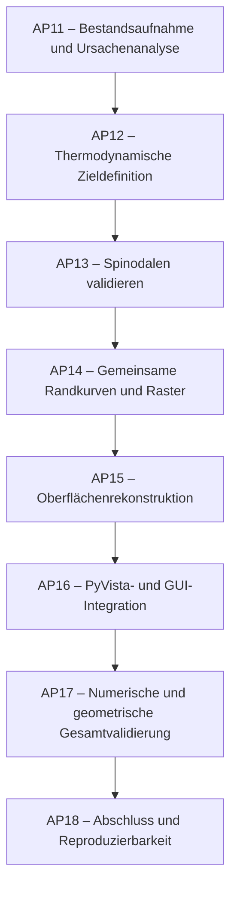

# ThermoSurface – Entwicklungsplan AP11 bis AP18

**Projekt:** Thermodynamisch konsistente Rekonstruktion der 3D-p-v-T-Zustandsoberfläche  
**Planungsstand:** 21. Oktober 2026  
**Grundlage:** Aktueller Python-Projektstand, Projektanalyse und Arbeitspakete AP1–AP10, Masterarbeit von Tirapong Nualsri sowie die drei bereitgestellten Referenzabbildungen  
**Ziel:** Zusammenhängende Visualisierung von Gleichgewichtszuständen, Binodalen, Spinodalen sowie gegebenenfalls metastabilen und instabilen Zustandsbereichen  
**Auftragsumfang:** Ausschließlich Entwicklungsplanung und Spezifikation. **Keine Änderungen am vorhandenen Produktivcode.**  
**Verwendung:** Die acht Arbeitspakete sollen anschließend in separaten Chatverläufen einzeln umgesetzt und abgenommen werden.

---

## Abschnitt 1 – Übersicht der Arbeitspakete

### 1.1 Technische Gesamtbewertung

Die Codeanalyse zeigt, dass die fehlende Verbindung zwischen der orangefarbenen Zweiphasenfläche und den Spinodalästen **nicht primär auf eine unzureichende Rasterauflösung zurückzuführen ist**.

Die Ursache ist vor allem thermodynamischer Natur: Beide Darstellungen beschreiben unterschiedliche Zustände.

Die aktuelle ThermoSurface-Anwendung unterscheidet zwischen:

- **Gleichgewichts-Zweiphasenfläche:** Berechnung mit Sättigungsdruck und Dampfgehalt.
- **Einphasige Zustandsfläche:** Berechnung homogener beziehungsweise einphasiger Bereiche mit CoolProp HEOS.
- **Spinodalen:** Separat berechnete Stabilitätsgrenzen der homogenen Zustandsgleichung.

Die metastabilen und instabilen Bereiche, welche die Binodalen geometrisch mit den Spinodalen beziehungsweise die beiden Spinodaläste miteinander verbinden würden, fehlen derzeit als eigenständige Flächen.

Ein entscheidender Unterschied zur Referenzabbildung besteht darin, dass **Abbildung 71 der Masterarbeit von Tirapong Nualsri ausdrücklich eine unkorrigierte van-der-Waals-Zustandsfläche** zeigt. Die Referenz enthält somit den Verlauf einer homogenen Zustandsgleichung im Bereich, in dem das stabile Zweiphasengleichgewicht durch ein Druckplateau beschrieben wird. Vgl. *Masterarbeit_Nualsri_Tirapong_1870960_4CM.pdf*, Kapitel 4.4, Abbildung 71, gedruckte Seite 121 (PDF-Seite 138).

Daraus ergeben sich zwei unterschiedliche, wissenschaftlich sinnvolle Darstellungsarten:

1. **Gleichgewichtsmodell:** Stabile einphasige Zustände und die über Binodalen begrenzte Zweiphasenfläche.
2. **Homogene EOS-Fortsetzung:** Stabile, metastabile und gegebenenfalls instabile Zustandsabschnitte mit Spinodalen als Stabilitätsgrenzen.

Beide Darstellungen sollen unabhängig einblendbar sein und dürfen nicht durch eine thermodynamisch unzulässige Interpolation miteinander vermischt werden.

### 1.2 Festgestellte technische Ausgangssituation

| Bereich | Bestehende Implementierung | Relevanter Befund |
|---|---|---|
| Gleichgewichts-Zweiphasenfläche | `coolprop_heos_pvt.py` → `calc_two_phase_surface()` | Druck entspricht `p_sat(T)`, Volumen wird über `Q` berechnet. Spinodalen sind nicht beteiligt. |
| Kritischer Punkt | `main.py` → `berechne_daten()` | Binodalen erhalten den kritischen Punkt erst nach Erzeugung der Zweiphasenarrays. |
| Kritischer Flächenabschluss | `visualization.py` → `add_two_phase_surface()` | Das letzte unterkritische Q-Profil wird durch Dreiecke separat mit dem kritischen Punkt verbunden. |
| Einphasige Fläche | `visualization.py` → `create_single_phase_surface()` | Stabile Teilflächen werden an Binodalen begrenzt. Metastabile Zwischenflächen fehlen. |
| Flüssigkeitsspinodale | `coolprop_heos_pvt.py` → `calc_spinodale()` | CoolProp-Spinodaltracer dient als Ausgangspunkt. |
| Dampfspinodale | `spinodal_vapor_solver.py` | Zusätzlich ist eine temperaturparametrisierte Nullstellensuche mit adaptiver Verfeinerung vorhanden. |
| Spinodalauswahl | `main.py` → `berechne_daten()` | Auswahl zwischen bestehendem Tracer und neuem Dampfsolver über Qualitätskriterien. |
| Spinodalvalidierung | `Debug.py` → `test_spinodale_ableitung()` | Normiertes Ableitungsresiduum wird bereits geprüft, aber nur an ausgewählten Punkten. |
| Koordinatentransformation | `visualization.py` → `to_xyz()` | `x=log10(v/v_c)`, `y=T/T_c`, `z=log10(p/p_c)`. Nichtpositive Drücke sind nicht darstellbar. |
| Benutzeroberfläche | `gui.py` → `ThermoSurfaceWindow` | Separate Sichtbarkeit für Zustandsfläche, Spinodalen und Zweiphasengebiet bereits vorhanden. |

**Wichtige Erkenntnis:** Die Arbeitspakete AP1–AP10 haben bereits eine gemeinsame Temperaturbasis und eine randkonforme Konstruktion an den Binodalen vorbereitet. AP11–AP18 sollen darauf aufbauen, statt diese Funktionen neu zu entwickeln.

Die bisherige Funktion `validate_pvt_phase_boundaries()` überprüft jedoch vor allem die Übereinstimmung vorhandener Datenarrays. Eine vollständige Prüfung der später gerenderten Geometrie einschließlich Spinodalen und metastabilen Flächen ist damit noch nicht abgedeckt.

### 1.3 Übersicht AP11 bis AP18

| AP | Bezeichnung | Technischer Schwerpunkt | Betroffene Module | Abhängigkeit | Priorität |
|---|---|---|---|---|---|
| **AP11** | Bestandsaufnahme und Ursachenanalyse | Datenfluss, aktuelle Flächentopologie, Fehlerursachen | `main.py`, `coolprop_heos_pvt.py`, `visualization.py` | Keine | Sehr hoch |
| **AP12** | Thermodynamische Zielgeometrie | Stabilität, Phasenbereiche, HEOS-Machbarkeit, Zielmodell | `coolprop_heos_pvt.py`, `spinodal_vapor_solver.py`, Referenzmaterial | AP11 | Sehr hoch |
| **AP13** | Robuste Spinodalberechnung | Beide Spinodaläste, Nullstellen, Fluidabhängigkeit, kritischer Punkt | `coolprop_heos_pvt.py`, `spinodal_vapor_solver.py`, `Debug.py` | AP11–AP12 | Sehr hoch |
| **AP14** | Randkurven und Raster | Gemeinsame Stützstellen, exakte Ränder, kompatible Teilnetze | `coolprop_heos_pvt.py`, `main.py`, `visualization.py` | AP12–AP13 | Sehr hoch |
| **AP15** | Oberflächenrekonstruktion | Metastabile und optional instabile Flächen ergänzen, Gleichgewichtsfläche erhalten | `coolprop_heos_pvt.py`, `main.py` | AP14 | Sehr hoch |
| **AP16** | PyVista- und GUI-Integration | Neue Netze, getrennte Actors, Checkboxen und Visualisierung | `visualization.py`, `gui.py`, `main.py`, ggf. `config.yaml` | AP15 | Hoch |
| **AP17** | Numerische und geometrische Validierung | Stabilität, Randfehler, Fluidmatrix, kritische Grenzfälle | `Debug.py`, Testmodule, Berechnungsmodule | AP16 | Sehr hoch |
| **AP18** | Dokumentation und Endprüfung | Regression, Performance, wissenschaftliche Auswertung | Testskripte, `ap8_convergence.py`, `ap10_verify.py`, Dokumentation | AP17 | Hoch |

Die acht Arbeitspakete sind bewusst so getrennt, dass die numerischen Grundlagen vor dem Aufbau zusätzlicher PyVista-Flächen abgesichert werden.

**Abgrenzung:** Der Schwerpunkt bleibt ausschließlich beim p-v-T-Diagramm. Die bereits vorhandenen Diagrammtypen p-h-T, p-s-T, h-s-p und u-v-T werden nicht thermodynamisch umgebaut, sondern auf Regressionen geprüft.

---

## Abschnitt 2 – Vollständige Spezifikation der Arbeitspakete

## AP11 – Bestandsaufnahme und Ursachenanalyse der bestehenden Oberflächengeometrie

**Art:** Analyse – keine Implementierung.

### 1. Zielsetzung

Die vollständige Rekonstruktion des bestehenden p-v-T-Berechnungs- und Visualisierungspfades.

Es soll eindeutig bestimmt werden, weshalb die aktuelle Gleichgewichts-Zweiphasenfläche nicht mit den Spinodalästen verbunden ist und welche Abweichungen auf thermodynamische Unterschiede beziehungsweise auf numerische oder geometrische Ursachen zurückzuführen sind.

### 2. Ausgangssituation

Der aktuelle Code besitzt bereits drei relevante Berechnungsstrukturen:

- `multi_isotherm()` erzeugt das reguläre `T-v`-Raster der Zustandsfläche.
- `calc_two_phase_surface()` erstellt die Gleichgewichtsfläche aus den Binodalen und dem Dampfgehalt `Q`.
- `calc_spinodale()` beziehungsweise `calc_spinodale_vapor_temperature()` liefern getrennte Spinodalpunkte.

Die eigentliche Zweiphasenfläche wird durch

\[
v(T,Q)=(1-Q)\,v_l(T)+Q\,v_g(T)
\]

\[
p(T,Q)=p_{\mathrm{sat}}(T)
\]

definiert.

Damit ist die Fläche bereits mathematisch an die Binodalen gebunden, nicht jedoch an die Spinodalen.

Die Binodalen besitzen außerdem einen kritischen Endpunkt, während die Zweiphasenfläche ihren kritischen Abschluss erst durch den Renderer erhält.

### 3. Betroffene Dateien und Funktionen

| Datei | Funktionen |
|---|---|
| `main.py` | `berechne_daten()`, `berechne_auswahl()` |
| `coolprop_heos_pvt.py` | `multi_isotherm()`, `multi_binodale()`, `calc_two_phase_surface()`, `berechne_zweiphasenmaske()` |
| `coolprop_heos_pvt.py` | `calc_spinodale()`, `prepare_spinodal_branch()`, `validate_pvt_phase_boundaries()` |
| `visualization.py` | `create_single_phase_surface()`, `_mesh_from_rows()`, `add_two_phase_surface()`, `render_pvt()`, `to_xyz()` |
| `gui.py` | `CalculationWorker`, `ThermoSurfaceWindow._calculation_ready()` |
| `config.yaml` | Temperatur-, Volumen- und Zweiphasenraster |

### 4. Konkrete Aufgabenstellung

1. Den vollständigen Datenfluss zwischen Stoffauswahl, CoolProp, Rasterberechnung und PyVista dokumentieren.
2. Die Berechnungsreihenfolge von `surface`, `phase_mask`, `binodal_liquid`, `binodal_vapor`, `spinodale_liquid`, `spinodale_vapor` und `two_phase_surface` untersuchen.
3. Für jedes Array die Dimensionen, Einheiten, physikalische Bedeutung und Erzeugungsfunktion dokumentieren.
4. Untersuchen, ob die Einphasenflächen an den Binodalen mathematisch korrekt abgeschnitten und trianguliert werden.
5. Die geometrische Abweichung zwischen Zweiphasenfläche und Spinodalästen an identischen Temperaturen quantitativ beschreiben.
6. Den Anschluss der Binodalen und der Zweiphasenfläche am kritischen Punkt getrennt prüfen.
7. Untersuchen, ob außerhalb der thermodynamisch bedingten Abweichungen zusätzliche numerische Lücken bestehen.
8. Die unterschiedlichen Perspektiven der Referenzbilder geometrisch vergleichen.

### 5. Technische Anforderungen

Die Analyse muss drei Fehlerklassen unterscheiden:

| Fehlerklasse | Beispiel |
|---|---|
| Thermodynamisch | Unterschied zwischen homogenem Spinodaldruck und Sättigungsdruck |
| Numerisch | Fehlende Spinodalstützstellen, unzureichende Konvergenz |
| Geometrisch | Unterschiedliche Randknoten oder fehlerhafte Triangulation |

Die Unterschiede sind in physikalischen Koordinaten `(T, v, p)` und nach der Transformation in PyVista-Koordinaten zu untersuchen.

### 6. Abhängigkeiten

Keine. AP11 bildet die technische Grundlage für alle nachfolgenden Arbeitspakete.

### 7. Validierung und Tests

Die Analyse ist anhand mindestens eines vollständig ausgewerteten Wasser-Datensatzes durchzuführen. Zusätzlich sollen die relevanten Arrayformen und vorhandenen Validierungsfunktionen überprüft werden.

### 8. Akzeptanzkriterien

- Jede relevante Fläche und Randkurve besitzt eine dokumentierte Datenquelle.
- Der komplette Datenfluss ist nachvollziehbar.
- Die beobachteten Abweichungen sind nach Fehlerklasse eingeordnet.
- Die für spätere Erweiterungen notwendigen Eingriffspunkte sind eindeutig bestimmt.
- Es verbleibt keine ungeklärte Zuordnung zwischen den bestehenden Ergebnisarrays und PyVista-Actors.

### 9. Erwartete Ergebnisse

Eine technische Analysedokumentation `README_AP11.md` mit Datenfluss, Arrayübersicht, Ursachenbewertung und konkreten Integrationspunkten. Noch keine Änderungen am Produktivcode.

---

## AP12 – Thermodynamische Zielgeometrie und Machbarkeitsprüfung mit CoolProp HEOS

**Art:** Konzept und Entscheidungspunkt.

### 1. Zielsetzung

Definition einer physikalisch korrekten 3D-Zielgeometrie, die den Referenzabbildungen möglichst nahekommt, ohne das Gleichgewichtszweiphasengebiet mit metastabilen oder instabilen Zuständen zu verwechseln.

Zudem muss festgestellt werden, welche dieser Zustandsbereiche CoolProp HEOS zuverlässig berechnen kann.

### 2. Ausgangssituation

Die aktuelle ThermoSurface-Anwendung berechnet hauptsächlich Gleichgewichtszustände.

Die Referenz aus der Masterarbeit basiert dagegen auf einer unkorrigierten van-der-Waals-Zustandsfläche. Deshalb ist eine unmittelbare geometrische Reproduktion mit der bestehenden Gleichgewichtsfläche nicht möglich.

Die angestrebte Darstellung muss aus thermodynamisch eindeutig klassifizierten Teilflächen bestehen.

### 3. Betroffene Dateien und Funktionen

- `coolprop_heos_pvt.py`: `p_eos()`, `calc_isotherme()`, `calc_spinodale()`
- `coolprop_heos_common.py`: `_new_state()`, `critical_point()`
- `spinodal_vapor_solver.py`: `_homogeneous_derivative()`, `_homogeneous_pressure()`
- `Debug.py`: `test_spinodale_ableitung()`
- Masterarbeit Nualsri, insbesondere Kapitel 3.1 und Abbildung 71

### 4. Konkrete Aufgabenstellung

1. Die thermodynamischen Zustandsbereiche anhand der Binodalen und Spinodalen definieren.
2. Für unterkritische Temperaturen die geometrische Reihenfolge der Phasengrenzen festlegen.
3. Den Zusammenhang zwischen Druckableitung und mechanischer Stabilität dokumentieren.
4. Prüfen, ob die homogene HEOS-Zustandsgleichung durch Phasenvorgabe mit `specify_phase()` im metastabilen Bereich zuverlässig ausgewertet werden kann.
5. Prüfen, ob eine Auswertung innerhalb der Spinodalen unterstützt wird.
6. Die Unterschiede zwischen einer homogenen EOS-Fortsetzung und dem thermodynamischen Zweiphasengleichgewicht festlegen.
7. Entscheiden, ob eine zusätzliche Zustandsgleichung als optionales Demonstrationsmodell erforderlich ist.
8. Eine verbindliche geometrische Zieldefinition für AP13–AP16 erstellen.

### 5. Technische Anforderungen

Für eine gewöhnliche unterkritische Flüssigkeit-Dampf-Isotherme sind folgende Bereiche zu unterscheiden:

**Schematische Volumenfolge einer unterkritischen Isotherme** (nicht maßstäblich):

| Volumenbereich | Klassifikation der homogenen EOS |
|---|---|
| `v < v_l` | Stabile Flüssigkeit |
| `v_l < v < v_spin,l` | Metastabile Flüssigkeit |
| `v_spin,l < v < v_spin,v` | Mechanisch instabile homogene Fortsetzung |
| `v_spin,v < v < v_v` | Metastabiler Dampf |
| `v > v_v` | Stabiler Dampf |

Hierbei sind `v_l` und `v_v` Sättigungsvolumina, `v_spin,l` und `v_spin,v` Spinodalvolumina. Die Tabelle beschreibt die **homogene Zustandsgleichung**, nicht das Gleichgewichts-Druckplateau. Die konkrete Ordnung und Gültigkeit ist für den Stoff und die Temperatur in AP12 zu überprüfen.

Für das homogene Modell gilt außerhalb besonderer Grenzfälle:

\[
\left(\frac{\partial p}{\partial v}\right)_T
\begin{cases}
<0 & \text{mechanisch lokal stabil},\\
=0 & \text{Spinodale},\\
>0 & \text{mechanisch instabil}.
\end{cases}
\]

Metastabile Zustände besitzen weiterhin positive isotherme Kompressibilität, obwohl sie gegenüber der Ausbildung eines Zweiphasengleichgewichts nicht global stabil sind.

Eine spinodalbegrenzte Fläche darf deshalb nicht als Gleichgewichts-Zweiphasenfläche bezeichnet werden.

### 6. Abhängigkeiten

AP11. Insbesondere werden dessen Datenflussanalyse und Zuordnung der vorhandenen Zustandsflächen benötigt.

### 7. Validierung und Tests

Die Machbarkeit der homogenen Fortsetzung muss für Wasser und mindestens einen weiteren Reinstoff untersucht werden.

Für ausgewählte unterkritische Temperaturen sollen jeweils Zustände zwischen Binodale und Spinodale überprüft werden. Entscheidend sind Druck, Stabilitätsableitung, Phasenzuordnung und Reproduzierbarkeit.

### 8. Akzeptanzkriterien

- Alle gewünschten Flächen sind thermodynamisch eindeutig definiert.
- Die Rolle von Binodalen und Spinodalen ist festgelegt.
- Die Berechenbarkeit der metastabilen und instabilen Zustände mit HEOS ist anhand realer Zustandspunkte geprüft.
- Eine dokumentierte Entscheidung über die Berechnungsstrategie liegt vor.
- Keine geometrische Verbindung setzt eine physikalisch unzulässige Druckinterpolation voraus.

### 9. Erwartete Ergebnisse

`README_AP12.md` mit Zielgeometrie und einer verbindlichen Entscheidung:

- **Strategie A – Bevorzugt:** Homogene Fortsetzung mit CoolProp HEOS, sofern numerisch zuverlässig möglich.
- **Strategie B – Optional:** Separate homogene Zustandsgleichung für Bereiche, die mit HEOS nicht zuverlässig zugänglich sind. Ein zusätzlicher EOS-Datensatz darf nicht unbemerkt mit HEOS-Phasengrenzen zu einer vermeintlich einheitlichen Stoffoberfläche verbunden werden.

---

## AP13 – Robuste Berechnung und Validierung beider Spinodaläste

**Art:** Numerische Grundlage.

### 1. Zielsetzung

Die Berechnung beider Spinodaläste soll so robust gestaltet werden, dass sie über möglichst viele unterstützte Reinstoffe funktioniert.

Gleichzeitig müssen unvollständige oder thermodynamisch unplausible Ergebnisse zuverlässig erkannt und ausgewiesen werden.

### 2. Ausgangssituation

Der aktuelle Code verwendet zwei Berechnungsmethoden:

- `calc_spinodale()` mit `build_spinodal()` und `get_spinodal_data()` liefert beide Äste.
- `calc_spinodale_vapor_temperature()` berechnet den Dampfzweig temperaturparametrisiert über Nullstellen der Druckableitung.

In `main.berechne_daten()` wird anhand von Abdeckung, Übereinstimmung und numerischen Kriterien entschieden, ob der neue Dampfsolver oder der bestehende Tracer verwendet wird.

Für die Flüssigkeitsspinodale gibt es bisher keinen entsprechenden temperaturparametrisierten Alternativsolver.

Die Berechnung ist daher noch nicht symmetrisch aufgebaut.

### 3. Betroffene Dateien und Funktionen

| Datei | Funktionen |
|---|---|
| `coolprop_heos_pvt.py` | `calc_spinodale()`, `filter_spinodale()`, `prepare_spinodal_branch()` |
| `spinodal_vapor_solver.py` | `calc_spinodale_vapor_temperature()`, `_brackets()`, `_homogeneous_derivative()`, `compare_spinodal_overlap()` |
| `Debug.py` | `test_spinodale_ableitung()` |
| `main.py` | `berechne_daten()` |
| `config.yaml` | `spinodale_grid`, `spinodale_visu` |

### 4. Konkrete Aufgabenstellung

1. Den bestehenden CoolProp-Spinodaltracer hinsichtlich beider Äste untersuchen.
2. Die bisherige temperaturparametrisierte Dampfspinodale auf Konvergenz, Vollständigkeit und Konsistenz prüfen.
3. Die Machbarkeit eines analogen temperaturparametrisierten Flüssigkeitssolvers untersuchen.
4. Die Nullstellensuche auf stoffabhängige Dichteintervalle aufbauen.
5. Vor jeder Nullstellensuche die Sättigungsdichten und kritischen Größen bestimmen.
6. Nullstellen nach Ast, Ableitungsvorzeichen und physikalischer Plausibilität klassifizieren.
7. Adaptive Rasterverfeinerung nur bei tatsächlich unzureichender Auflösung durchführen.
8. Mehrdeutige Nullstellen und fehlgeschlagene HEOS-Auswertungen gesondert dokumentieren.
9. Den Verlauf zum kritischen Punkt untersuchen und unzulässige Endpunktergänzungen verhindern.
10. Die Ergebnisse des bisherigen Spinodaltracers und der neuen Berechnungsmethode quantitativ vergleichen.

### 5. Technische Anforderungen

Als wesentliches Spinodalkriterium gilt:

\[
\left(\frac{\partial p}{\partial \rho_m}\right)_T=0
\]

mit der molaren Dichte `rho_m=1/v`.

Für die Validierung kann das bereits verwendete dimensionslose Residuum genutzt werden:

\[
R_s=\left|\frac{\rho_c}{p_c}
\left(\frac{\partial p}{\partial \rho_m}\right)_T\right|.
\]

Eine kleine Residualabweichung allein reicht allerdings nicht aus. Zusätzlich sind der richtige Ast und der erwartete Vorzeichenwechsel der Ableitung nachzuweisen.

**Besondere Anforderungen:**

- Suchintervalle aus Stoffdaten und Sättigungsgrenzen ableiten, nicht aus festen Wasser-Parametern.
- Keine künstlichen Spinodalpunkte erzeugen, um Kurvenlücken zu schließen.
- Bei nichtpositivem Druck den thermodynamischen Datenpunkt von seiner logarithmischen Darstellbarkeit unterscheiden.
- Die kritische Umgebung separat behandeln, da beide Äste dort zusammenlaufen und numerisch schwer auflösbar werden.
- Keine vollständige Spinodale garantieren, wenn CoolProp das entsprechende Fluid oder den relevanten Zustandsbereich nicht zuverlässig unterstützt.

### 6. Abhängigkeiten

AP11 und AP12. Die Zielgeometrie sowie die zulässige homogene Berechnungsstrategie müssen vorliegen.

### 7. Validierung und Tests

Vorgesehen sind:

- Wasser als primärer Referenzstoff.
- R134a als zweiter Stoff mit anderem kritischem Temperaturbereich.
- CO₂ und Argon als zusätzliche Robustheitsfälle.
- Mehrere Temperaturstützstellen zwischen etwa `0,9 T_c` und `0,999 T_c`, soweit das Modell dort belastbare Daten liefert.
- Konvergenzvergleich mehrerer Dichte- und Temperaturauflösungen.
- Direkter Vergleich der beiden Berechnungsmethoden.
- Prüfung unvollständiger und mehrdeutiger Nullstellenergebnisse.

### 8. Akzeptanzkriterien

- Beide Spinodaläste werden unabhängig validiert.
- Gültige Punkte erfüllen das normierte Ableitungskriterium innerhalb einer begründeten Toleranz.
- Fehlende Punkte sind als fehlend erkennbar und werden nicht überbrückt.
- Ein vorhandener kritischer Endpunkt wird nur unter den in AP12 festgelegten Bedingungen ergänzt.
- Mindestens zwei geeignete Reinstoffe liefern ausreichend vollständige Äste für die folgende Flächenrekonstruktion.
- Nicht unterstützte Stoffe führen zu einer kontrollierten, dokumentierten Einschränkung.

### 9. Erwartete Ergebnisse

Überarbeitete oder ergänzte Spinodalfunktionen in den bestehenden Berechnungsmodulen, zusätzliche Tests und eine Dokumentation `README_AP13.md`.

Die bisherigen öffentlichen Schnittstellen sollen erhalten bleiben, insbesondere die Arrays `(n, 3)` in der Reihenfolge `(T, v, p)`.

---

## AP14 – Einheitliche Randkurven, Temperaturstützstellen und geometrische Schnittstellen

**Art:** Geometrische Grundlage.

### 1. Zielsetzung

Alle Flächenabschnitte sollen dort exakt dieselben Randkoordinaten verwenden, wo sie physikalisch zusammengehören.

Damit sollen numerische Lücken, Überlappungen und unterschiedliche Randverläufe bei der späteren Triangulation vermieden werden.

### 2. Ausgangssituation

Durch AP2 wurde bereits `build_pvt_temperature_grid()` eingeführt. Diese Funktion erzeugt kompatible Temperaturstützstellen für Zustandsfläche und Binodalen.

Die Spinodalen besitzen dagegen eigenständige Temperaturstützstellen.

Außerdem unterscheiden sich die Topologien von einphasiger Fläche und Zweiphasenfläche. Die letztere besitzt keine eigene kritische Q-Zeile.

Die spätere Integration weiterer Oberflächen benötigt deshalb eine erweiterte, gemeinsame Randdatenstruktur.

### 3. Betroffene Dateien und Funktionen

- `coolprop_heos_pvt.py`: `build_pvt_temperature_grid()`, `multi_binodale()`, `prepare_spinodal_branch()`, `calc_two_phase_surface()`, `validate_pvt_phase_boundaries()`
- `main.py`: `berechne_daten()`
- `visualization.py`: `_mesh_from_rows()`, `create_single_phase_surface()`, `add_two_phase_surface()`
- `coolprop_heos_common.py`: `critical_point()`

### 4. Konkrete Aufgabenstellung

1. Eine zentrale Zuordnung der thermodynamischen Randkurven je Temperaturstützstelle definieren.
2. Die vorhandene gemeinsame Temperaturbasis für die Gleichgewichtsfläche erhalten.
3. Die tatsächlich validierten Spinodalstützstellen an die benötigten Temperaturzeilen anbinden.
4. Fehlende Spinodalzustände explizit berücksichtigen, statt über ungültige Bereiche zu interpolieren.
5. Binodal- und Spinodalkoordinaten für jede relevante Teilfläche als gemeinsame Randpunkte bereitstellen.
6. Den kritischen Punkt als gemeinsamen singulären Endknoten definieren.
7. Für jede spätere Teilfläche die gewünschte Punktreihenfolge und Netzorientierung spezifizieren.
8. Kontrollieren, dass identische physikalische Randpunkte nach `to_xyz()` dieselben Darstellungskoordinaten ergeben.
9. Die vorhandene Phasengrenzenvalidierung um Randbedingungen der metastabilen und optional instabilen Bereiche erweitern.

### 5. Technische Anforderungen

Die Flächen sollen über dieselben gespeicherten Randknoten verbunden werden.

Dies betrifft insbesondere:

| Verbindung | Gemeinsame Randkurve |
|---|---|
| Stabile Flüssigkeitsfläche ↔ Gleichgewichtsfläche | Siedelinie |
| Stabile Dampffläche ↔ Gleichgewichtsfläche | Taulinie |
| Stabile Flüssigkeitsfläche ↔ metastabile Flüssigkeitsfläche | Siedelinie |
| Stabile Dampffläche ↔ metastabile Dampffläche | Taulinie |
| Metastabile Flüssigkeitsfläche ↔ instabile Fortsetzungsfläche | Flüssigkeitsspinodale |
| Metastabile Dampffläche ↔ instabile Fortsetzungsfläche | Dampfspinodale |

Die letzten beiden Verbindungen gelten nur, wenn die instabile homogene Fortsetzung tatsächlich berechenbar ist.

Die beiden thermodynamischen Darstellungsarten dürfen geometrisch gemeinsame Binodalknoten besitzen, sind aber nicht als eine einzige physikalische Gleichgewichtsfläche zu interpretieren.

### 6. Abhängigkeiten

AP12 und AP13. Insbesondere werden validierte Spinodaläste und die festgelegte Zielgeometrie benötigt.

### 7. Validierung und Tests

Die exakte Randpunktübereinstimmung ist vor und nach der Koordinatentransformation zu prüfen.

Zusätzlich sind die Temperaturreihenfolge, die Zuordnung der Phasengrenzen und die Netzorientierung zu kontrollieren.

### 8. Akzeptanzkriterien

- Gemeinsame Randpunkte stammen aus einer gemeinsamen Datenquelle.
- Exakte Randknotenidentität wird durch Arrayvergleiche nachgewiesen.
- Es entstehen keine künstlichen Temperaturzeilen oder Spinodalpunkte.
- Alle relevanten Teilflächen besitzen kompatible Randorientierungen.
- Der kritische Punkt ist konsistent definiert.
- Die bisherige AP2-Validierung bleibt funktionsfähig.

### 9. Erwartete Ergebnisse

Erweiterte Randdaten und Validierungsfunktionen, möglichst innerhalb von `coolprop_heos_pvt.py`.

Eine separate Geometrie-Hilfsdatei soll nur entstehen, wenn die vorhandenen Funktionen andernfalls unnötig komplex würden.

Dokumentation in `README_AP14.md`.

---

## AP15 – Thermodynamisch korrekte Rekonstruktion und Erweiterung der p-v-T-Zustandsoberfläche

**Art:** Zentrales Implementierungspaket.

### 1. Zielsetzung

Erweiterung der bestehenden p-v-T-Zustandsberechnung um die thermodynamisch zulässigen homogenen Zustandsflächen zwischen Binodalen und Spinodalen.

Optional soll eine instabile Fortsetzungsfläche zwischen den Spinodalästen ergänzt werden.

Die bereits vorhandene Gleichgewichts-Zweiphasenfläche muss erhalten bleiben.

### 2. Ausgangssituation

Die aktuelle Funktion `create_single_phase_surface()` verwendet die Binodalen als Randkurven der stabilen Einphasenflächen.

Die orange Gleichgewichtsfläche wird separat durch `calc_two_phase_surface()` aufgebaut.

Zwischen Binodale und Spinodale sowie innerhalb der Spinodalen existieren derzeit keine eigenen Flächendatensätze.

Für eine Darstellung analog zur unkorrigierten Referenzfläche müssen zusätzliche Zustandsdaten erzeugt werden.

### 3. Betroffene Dateien und Funktionen

| Datei | Betroffene Bestandteile |
|---|---|
| `coolprop_heos_pvt.py` | `p_eos()`, `calc_isotherme()`, `calc_two_phase_surface()` und neue Hilfsfunktionen für die homogene Fortsetzung |
| `coolprop_heos_common.py` | `_new_state()` |
| `main.py` | `berechne_daten()`, Ergebnis-Dictionary |
| `Debug.py` | Erweiterung der thermodynamischen Prüfungen |
| `limits.py` | Bestehendes Punktlimit zur Ressourcenbegrenzung |

Die eigentliche PyVista-Integration ist nicht Bestandteil dieses Arbeitspakets.

### 4. Konkrete Aufgabenstellung

1. Die bestehende Gleichgewichts-Zweiphasenfläche als unveränderte Referenzberechnung erhalten.
2. Die metastabile Flüssigkeitsfläche zwischen Siedelinie und Flüssigkeitsspinodale berechnen.
3. Die metastabile Dampffläche zwischen Taulinie und Dampfspinodale berechnen.
4. Für jeden zusätzlichen Oberflächenpunkt die homogene Zustandsgleichung auswerten.
5. Geeignete Punktverteilungen zwischen den Randkurven erzeugen.
6. Die berechneten Zustände nach Stabilitätskriterien klassifizieren.
7. Prüfen, ob sich die instabile Fläche zwischen beiden Spinodalästen zuverlässig berechnen lässt.
8. Falls zulässig, die instabile Fläche als zusätzlichen eigenständigen Datensatz erstellen.
9. Alle Randkoordinaten aus AP14 übernehmen.
10. Neue Flächendaten rückwärtskompatibel in das Ergebnis-Dictionary integrieren.

### 5. Technische Anforderungen

Die metastabile Flüssigkeitsfläche wird für jede zulässige Temperatur zwischen

\[
v_l(T)\leq v\leq v_{\mathrm{spin},l}(T)
\]

aufgespannt.

Die metastabile Dampffläche befindet sich zwischen

\[
v_{\mathrm{spin},v}(T)\leq v\leq v_v(T).
\]

Die gegebenen Volumengrenzen gelten unter der in AP12 geprüften gewöhnlichen Flüssigkeit-Dampf-Topologie.

Für die eigentliche Druckberechnung gilt:

\[
p=p_{\mathrm{hom}}(T,v)
\]

und ausdrücklich **nicht**

\[
p=p_{\mathrm{sat}}(T).
\]

Der Druck der zusätzlichen Flächen muss folglich aus der homogenen Zustandsgleichung stammen.

Für eine gegebenenfalls darstellbare instabile Fläche gilt entsprechend:

\[
v_{\mathrm{spin},l}(T)\leq v\leq v_{\mathrm{spin},v}(T).
\]

Es darf keine künstliche Verbindung durch lineare Interpolation zwischen den beiden Spinodaldrücken erzeugt werden. Jeder Punkt muss aus einer thermodynamisch begründeten Zustandsgleichung stammen.

**Vorgesehene Flächendaten:**

| Datensatz, vorgeschlagener Schlüssel | Inhalt |
|---|---|
| `surface` | Bestehende Zustandsoberfläche |
| `two_phase_surface` | Bestehende Gleichgewichts-Zweiphasenfläche |
| `metastable_liquid_surface` | Metastabile Flüssigkeitsfläche |
| `metastable_vapor_surface` | Metastabile Dampffläche |
| `unstable_surface` | Instabile homogene Fortsetzung, optional |
| `binodal_liquid`, `binodal_vapor` | Bestehende Binodaläste |
| `spinodale_liquid`, `spinodale_vapor` | Validierte Spinodaläste |

Die neuen Namen sind ein vorgeschlagener Schnittstellenvertrag für AP15 und AP16.

### 6. Abhängigkeiten

AP14. Die notwendigen Randkurven müssen thermodynamisch validiert und geometrisch konsistent sein.

### 7. Validierung und Tests

Für jede zusätzliche Fläche ist zu prüfen:

- Endliche und physikalisch interpretierbare Zustandsgrößen.
- Passende Position zwischen den festgelegten Randkurven.
- Korrektes Vorzeichen der mechanischen Stabilitätsableitung.
- Übereinstimmung des Randdruckes mit dem jeweils zugehörigen homogenen Spinodalzustand.
- Kein unbeabsichtigter Übergang auf einen Gleichgewichts-Flash.
- Reproduzierbare Berechnung für mindestens zwei geeignete Reinstoffe.

### 8. Akzeptanzkriterien

- Beide metastabilen Flächen werden für die nach AP12/AP13 unterstützten Zustandsbereiche korrekt berechnet.
- Die bestehenden Sättigungs- und Zweiphasenberechnungen bleiben unverändert gültig.
- Die Flächen schließen numerisch exakt an die vorgesehenen Randkurven an.
- Keine interpolierten Ersatzwerte verschleiern fehlende HEOS-Ergebnisse.
- Eine instabile Fläche wird nur freigegeben, wenn ihre thermodynamische Auswertung erfolgreich validiert ist.
- Bestehende Ergebnis-Keys und öffentliche Berechnungsschnittstellen bleiben nutzbar.

### 9. Erwartete Ergebnisse

Neue Berechnungsfunktionen für die metastabilen und gegebenenfalls instabilen Zustandsflächen sowie ein erweitertes p-v-T-Ergebnis-Dictionary.

Die Flächenberechnung muss vollständig unabhängig von PyVista und GUI erfolgen.

`README_AP15.md` dokumentiert die thermodynamischen Gleichungen, die Numerik und die Einschränkungen.

---

## AP16 – Integration der rekonstruierten Oberflächen in PyVista und GUI

**Art:** Visualisierung und Bedienung.

### 1. Zielsetzung

Die zusätzlichen Zustandsflächen sollen vollständig in die vorhandene ThermoSurface-Anwendung integriert werden.

Jeder thermodynamische Bereich muss korrekt dargestellt und unabhängig sichtbar beziehungsweise unsichtbar geschaltet werden können.

### 2. Ausgangssituation

Die aktuelle PyVista-Visualisierung verwendet getrennte Actors für die bestehende Zustandsfläche, die Binodalen, die Spinodalen und das Zweiphasengebiet.

Die GUI speichert diese Actors in `self.actors` und steuert ihre Sichtbarkeit über `self.layer_checks`.

Damit ist die Architektur für zusätzliche Flächen bereits grundsätzlich vorbereitet.

### 3. Betroffene Dateien und Funktionen

- `visualization.py`: `render_pvt()`, `_mesh_from_rows()`, `create_single_phase_surface()`, `to_xyz()`
- `gui.py`: `ThermoSurfaceWindow.setup_controls()`, `_calculation_ready()`, `set_layer_visibility()`, `apply_layer_visibility()`, `_apply_render_layers()`, `on_surface_grid_toggled()`
- `main.py`: `berechne_daten()`
- `config.yaml`: gegebenenfalls zusätzliche Visualisierungsparameter

### 4. Konkrete Aufgabenstellung

1. PyVista-Netze aus den neuen Flächendaten von AP15 erzeugen.
2. Die vorhandene `_mesh_from_rows()`-Logik auf Wiederverwendbarkeit prüfen.
3. Triangulation und Zellorientierung auf Lücken und Überschneidungen prüfen.
4. Für metastabile Flüssigkeits- und Dampfflächen eigene PyVista-Actors einführen.
5. Für die optionale instabile Fläche einen weiteren Actor integrieren.
6. Die neuen Actors in `render_pvt()` aufnehmen.
7. Für die neuen Zustandsbereiche separate GUI-Checkboxen ergänzen.
8. Die vorhandene Oberflächengitter-Steuerung auf die neuen Flächen ausdehnen.
9. Die Sichtbarkeitslogik für die anderen Diagrammtypen unverändert erhalten.
10. Transparenz, Farben und Schattierung so abstimmen, dass sich die physikalischen Bereiche eindeutig unterscheiden lassen.

### 5. Technische Anforderungen

**Vorgeschlagene GUI-Struktur (konzeptionell):**

- [x] Stabile Zustandsoberfläche
- [x] Gleichgewichts-Zweiphasengebiet
- [x] Metastabile Flüssigkeitsfläche
- [x] Metastabile Dampffläche
- [ ] Instabile Zustandsfläche (optional)
- [x] Binodalen
- [x] Spinodalen
- [x] Kritischer Punkt
- [ ] Oberflächengitter

Die Markierungen sind nur eine **schematische Voreinstellung** und keine implementierte oder verbindlich festgelegte GUI-Einstellung.

Die vorhandenen Checkboxen für Gleichgewichtsfläche, Spinodalen und Binodalen bleiben erhalten.

Die neuen Flächen erhalten eigene Einträge im Actor-Dictionary. Der Renderer darf die bestehende `surface`-Geometrie nicht überschreiben.

Für Zustände mit `p <= 0` ist bei logarithmischer Druckachse ein kontrolliertes Ausblenden erforderlich. Dadurch entstehende Ausschnitte müssen als Darstellungsgrenze und nicht als physikalisch fehlende Zustände behandelt werden.

### 6. Abhängigkeiten

AP15. Sämtliche zusätzlichen Flächendaten müssen bereits vollständig vorliegen und numerisch validiert sein.

### 7. Validierung und Tests

- Ein- und Ausblenden jedes Flächenbereiches ohne Neuberechnung.
- Kontrolle der Binodal- und Spinodalkurven bei aktiven und inaktiven Flächen.
- Prüfung des kritischen Anschlusses.
- Prüfung mehrerer 3D-Kameraperspektiven.
- Prüfung verschiedener Rasterdichten und Oberflächengitter-Einstellungen.
- Funktionstest beim Wechsel zwischen p-v-T und allen weiteren Diagrammtypen.

### 8. Akzeptanzkriterien

- Alle unterstützten Flächen lassen sich unabhängig ein- und ausblenden.
- Die physikalisch zusammengehörenden Randkurven liegen sichtbar und geometrisch korrekt auf den entsprechenden Flächen.
- Keine fehlerhaften Dreiecksverbindungen oder ungewollten Oberflächenüberschneidungen treten in gültigen Bereichen auf.
- Die Anwendung bleibt interaktiv bedienbar.
- Die bestehenden Diagrammtypen und GUI-Funktionen werden nicht beeinträchtigt.

### 9. Erwartete Ergebnisse

Erweiterte PyVista- und GUI-Funktionen mit getrennten Actors und Sichtbarkeitsoptionen.

`README_AP16.md` mit Darstellung der neuen GUI-Struktur, der Actor-Zuordnung und dokumentierten Vorher-Nachher-Ansichten.

---

## AP17 – Umfassende numerische, thermodynamische und geometrische Validierung

**Art:** Wissenschaftlicher Nachweis.

### 1. Zielsetzung

Die Ergebnisse aus AP13–AP16 müssen anhand objektiver Testkriterien nachweisen, dass die rekonstruierten Zustandsflächen thermodynamisch und geometrisch konsistent sind.

Der Schwerpunkt liegt auf dem Nachweis der korrekten Randverbindungen und der zuverlässigen Erkennung nicht unterstützter Zustände.

### 2. Ausgangssituation

Der bisherige Projektstand enthält bereits Tests für Binodalen, Spinodalen, kritische Punkte und geometrische Konsistenz.

Es fehlen jedoch noch systematische Tests für die neu geplanten metastabilen und instabilen Flächen.

Außerdem müssen die Tests reale HEOS-Berechnungen, geometrische Netzprüfungen und die Visualisierung getrennt absichern.

### 3. Betroffene Dateien und Funktionen

- `Debug.py`: `test_spinodale_ableitung()`, `diagnose_visualisierung()`
- `coolprop_heos_pvt.py`: `validate_pvt_phase_boundaries()` und neue Validierungsfunktionen
- `test_spinodal_extension.py`
- `validate_spinodal_heos.py`
- `Test.py`, `test_ap4.py`
- `visualization.py`: Flächennetzfunktionen

### 4. Konkrete Aufgabenstellung

1. Eine reproduzierbare Testmatrix für mehrere Reinstoffe erstellen.
2. Beide Spinodaläste quantitativ validieren.
3. Die metastabilen Flächen anhand ihrer thermodynamischen Stabilität überprüfen.
4. Die optional instabile Fläche auf mechanische Instabilität überprüfen.
5. Gemeinsame Randpunkte aller angrenzenden Teilflächen vergleichen.
6. Die Verbindung zum kritischen Punkt numerisch und geometrisch prüfen.
7. PyVista-Meshes auf degenerierte Dreiecke, ungewollte Überschneidungen und nicht unterstützte Lücken untersuchen.
8. Die Ergebnisse für unterschiedliche Rasterauflösungen vergleichen.
9. Die Resultate aus mehreren Kameraperspektiven dokumentieren.
10. Die bestehenden Diagrammtypen auf Regressionen prüfen.

### 5. Technische Anforderungen

Als Ausgangspunkt für die quantitativen Validierungsgrenzen werden folgende Kriterien vorgeschlagen:

| Prüfgröße | Vorgeschlagenes Kriterium |
|---|---|
| Gemeinsame physikalische Randknoten | Exakte Array-Identität bei gemeinsam gespeicherten Knoten |
| Transformierte Randkoordinaten | Maximale dimensionslose Abweichung höchstens `1e-10` |
| Sättigungsdruck zweier Binodaläste | Relative Abweichung höchstens `1e-8` |
| Normiertes Spinodalresiduum | Vorläufig höchstens `1e-3`, außerhalb einer gesondert definierten kritischen Umgebung |
| Stabilitätsprüfung | Korrektes Ableitungsvorzeichen außerhalb der Spinodalpunkte |
| Kritischer Punkt | Gemeinsame Koordinate `(T_c, v_c, p_c)` für alle zulässig angebundenen Bereiche |
| Netzqualität | Keine ungültigen Zellen oder unbeabsichtigten Verbindungen über fehlende Zustände |

Die genannten Toleranzen sind zunächst **Planungswerte**. Ihre endgültige Festlegung erfolgt nach Prüfung der tatsächlich erreichbaren HEOS-Konvergenz in AP13.

Beim kritischen Punkt muss zwischen exakter geometrischer Verbindung und numerischer Annäherung der thermodynamischen Spinodalberechnung unterschieden werden.

### 6. Abhängigkeiten

AP16 und damit sämtliche vorangegangenen Arbeitspakete.

### 7. Validierung und Tests

Als Teststoffe werden Wasser, R134a, CO₂ und Argon vorgesehen.

Für jeden Stoff soll eine Ergebnismatrix erstellt werden mit:

- Verfügbarkeit beider Spinodaläste.
- Anzahl gültiger beziehungsweise fehlender Stützstellen.
- Maximalem Spinodalresiduum.
- Gültigkeit metastabiler Zustandsflächen.
- Verfügbarkeit einer instabilen Fortsetzungsfläche.
- Maximaler Randabweichung.
- Verhalten in kritischen Grenzbereichen.
- Ergebnis der PyVista-Darstellung.

Die Auswertung muss zwischen bestandenen, fehlgeschlagenen und wegen fehlender Modellunterstützung nicht anwendbaren Tests unterscheiden.

### 8. Akzeptanzkriterien

- Die Gleichgewichtsfläche bleibt thermodynamisch korrekt.
- Die Spinodaläste sind für die unterstützten Stoffbereiche validiert.
- Metastabile und instabile Flächen erfüllen ihre jeweiligen Stabilitätskriterien.
- Alle gemeinsamen geometrischen Randknoten stimmen innerhalb der definierten Toleranzen überein.
- Die fehlende Verfügbarkeit eines Spinodalastes wird eindeutig angezeigt.
- Es treten keine nicht begründeten Netzübergänge auf.
- Alle bestehenden p-v-T-Regressionstests bestehen.
- Die übrigen Diagrammtypen bestehen ihre vorgesehenen Integrationstests.

### 9. Erwartete Ergebnisse

Ein automatisierbares Validierungspaket mit numerischen Ergebnisdaten, Prüftabellen und Fehlerprotokollen.

`README_AP17.md` dokumentiert die Prüfmethoden, Teststoffe, Toleranzen und tatsächlich erreichten Ergebnisse.

---

## AP18 – Abschlussdokumentation, Performanceprüfung und Regression

**Art:** Projektabschluss.

### 1. Zielsetzung

Die Erweiterung soll so dokumentiert und geprüft werden, dass sie als wissenschaftlich nachvollziehbarer Bestandteil der Studienarbeit verwendet werden kann.

Zusätzlich müssen die Rechenkosten und die Auswirkungen auf den bestehenden Programmumfang bewertet werden.

### 2. Ausgangssituation

Mit AP1–AP10 wurde bereits eine Grundlage für Regression, Konvergenzuntersuchungen und Reproduzierbarkeit geschaffen.

Die neuen Flächenberechnungen werden voraussichtlich zusätzliche HEOS-Auswertungen und PyVista-Zellen benötigen.

Eine abschließende Ressourcenbewertung ist deshalb erforderlich.

### 3. Betroffene Dateien und Funktionen

- `ap8_convergence.py`: `calculate()`, `choose_resolution()`
- `ap10_verify.py`: `provenance()`, `run_tests()`
- `snapshot_pvt.py`
- `compare_pvt.py`
- `Test.py`
- `test_ap4.py`
- `test_ap5_ap8.py`
- `test_spinodal_extension.py`
- `main.py`, `coolprop_heos_pvt.py`, `visualization.py`

Eine Einschränkung des bereitgestellten Projektbestands ist zu beachten: Die von vorhandenen Tests referenzierten Dateien `ap4_validation.py`, `ap6_reference.py` und `ap7_vdw_compare.py` liegen unter den aktuell bereitgestellten Dateien nicht vor. Auch gespeicherte Regressionsbaselines sind nicht enthalten. Ihre Verfügbarkeit beziehungsweise Wiederherstellung muss vor einer vollständigen Endabnahme geklärt werden.

### 4. Konkrete Aufgabenstellung

1. Die Berechnungszeit für die bisherige p-v-T-Darstellung und die erweiterten Oberflächen vergleichen.
2. Den zusätzlichen Speicherbedarf der neuen Arrays und PyVista-Netze untersuchen.
3. Mindestens drei unterschiedliche Rasterauflösungen vergleichen.
4. Die Genauigkeitsverbesserung gegen den zusätzlichen Rechenaufwand bewerten.
5. Wiederholte und unnötige HEOS-Auswertungen identifizieren.
6. Die vorhandenen Regressionstests an die neuen, optionalen Ergebnisdaten anpassen.
7. Den Einfluss auf die vier weiteren Diagrammtypen überprüfen.
8. Die vollständige mathematische und numerische Vorgehensweise dokumentieren.
9. Vergleichsabbildungen zwischen Gleichgewichtsfläche und homogener EOS-Fortsetzung erstellen.
10. Die finale Testumgebung mit Bibliotheksversionen und Einstellungen dokumentieren.

### 5. Technische Anforderungen

Die Performanceprüfung soll getrennt folgende Bestandteile erfassen:

- Reine thermodynamische Berechnung.
- Berechnung und Validierung der Spinodalen.
- Berechnung der zusätzlichen Flächen.
- Erstellung der PyVista-Netze.
- Gesamtlaufzeit bis zur fertigen Visualisierung.

Die bereits vorhandene Messmethodik aus AP8 soll soweit möglich wiederverwendet werden.

Die wissenschaftliche Dokumentation muss insbesondere erklären, warum eine vollständige geometrische Verbindung zur homogenen Spinodalfläche nicht durch die Gleichgewichts-Zweiphasenfläche allein hergestellt werden kann.

### 6. Abhängigkeiten

AP17. Sämtliche thermodynamischen und geometrischen Funktionen müssen zuvor validiert sein.

### 7. Validierung und Tests

Durchzuführen sind:

- Wiederholte Performance-Benchmarks.
- Vergleich der Ergebnisse bei unterschiedlichen Rasterdichten.
- Regressionsprüfung der bestehenden Diagramme.
- Prüfung der Ergebnisreproduzierbarkeit bei identischen Eingangsparametern.
- Vollständige Prüfung der GUI auf dem vorgesehenen Zielrechner.

### 8. Akzeptanzkriterien

- Eine dokumentierte Empfehlung für die Standardrasterauflösung liegt vor.
- Laufzeit und Speicherbedarf sind quantitativ erfasst.
- Die benötigten Testabhängigkeiten und Regressionsbaselines sind verfügbar.
- Die vorgesehenen Tests bestehen ohne stillschweigende Auslassung fehlgeschlagener Prüffälle.
- Sämtliche unterstützten thermodynamischen Bereiche sind wissenschaftlich korrekt bezeichnet.
- Die finale Anwendung kann mit einer dokumentierten Softwareumgebung reproduziert werden.

### 9. Erwartete Ergebnisse

Eine abgeschlossene Projektdokumentation `README_AP18.md` mit Testmatrix, Performanceergebnissen, Reproduzierbarkeitsanleitung und den für die Studienarbeit geeigneten Vergleichsabbildungen.

---

## Abschnitt 3 – Empfohlene Umsetzungsreihenfolge

Die Arbeitspakete sollten grundsätzlich sequenziell durchgeführt werden. Besonders wichtig sind die beiden Entscheidungspunkte AP12 und AP13, da die spätere Oberflächenrekonstruktion von der tatsächlich verfügbaren HEOS-Datenlage abhängt.

| Schritt | Zentrale Frage / Freigabebedingung |
|---|---|
| AP11 | Ist der bestehende Datenfluss vollständig verstanden? |
| AP12 | Welche zusätzlichen homogenen Zustände können mit HEOS korrekt dargestellt werden? |
| AP13 | Sind beide Spinodaläste in den benötigten Temperaturintervallen zuverlässig bestimmt? |
| AP14 | Sind alle gemeinsamen Randkurven identisch und netztechnisch anschlussfähig? |
| AP15 | Liegen korrekte, validierbare neue Flächendatensätze vor? |
| AP16 | Sind die neuen Datensätze in PyVista und GUI getrennt steuerbar? |
| AP17 | Bestehen die thermodynamischen und geometrischen Abnahmetests? |
| AP18 | Ist das Endergebnis dokumentiert, performant und reproduzierbar? |

### Empfohlene Priorisierung bei begrenzter Bearbeitungszeit

Da ThermoSurface bereits fünf Diagrammtypen enthält, sollte der Erweiterungsumfang kontrolliert bleiben.

Das fachliche Mindestziel der geplanten Erweiterung ist die Berechnung und Darstellung beider metastabiler Flächen für einen nachgewiesenen Stoffbereich. Die instabile homogene Fortsetzung ist eine zusätzliche wissenschaftliche Erweiterung und muss von ihrer tatsächlichen Berechenbarkeit abhängig bleiben.

Die Reihenfolge ist deshalb bewusst so gewählt, dass die bestehende Anwendung auch dann funktionsfähig und wissenschaftlich korrekt bleibt, wenn eine vollständige instabile Fortsetzungsfläche mit CoolProp HEOS nicht zuverlässig berechnet werden kann.

---

## Abschnitt 4 – Abschließende Erfolgskriterien

Die Arbeitspakete AP11–AP18 gelten als vollständig abgeschlossen, wenn die folgenden Anforderungen erfüllt sind.

| Nr. | Erfolgskriterium | Objektiver Nachweis |
|---|---|---|
| 1 | Gleichgewichts-Zweiphasenfläche bleibt korrekt | `p=p_sat(T)`, `v=(1-Q)v_l+Qv_g` |
| 2 | Binodalen liegen auf den jeweiligen Flächenrändern | Gemeinsame Randknoten |
| 3 | Beide Spinodaläste werden korrekt berechnet | Ableitungsresiduen und Astklassifikation |
| 4 | Metastabile Bereiche sind thermodynamisch konsistent | Homogene EOS-Auswertung und positive Kompressibilität |
| 5 | Instabile Bereiche werden nur bei Modellunterstützung dargestellt | Validierte homogene Zustände mit mechanischer Instabilität |
| 6 | Keine ungewollten geometrischen Lücken | Automatisierte Netz- und Randprüfungen |
| 7 | Kritischer Punkt ist konsistent angebunden | Identischer kritischer Endpunkt und dokumentierte Konvergenz |
| 8 | Unterschiedliche Reinstoffe werden robust behandelt | Stoffübergreifende Testmatrix |
| 9 | Alle relevanten Flächen sind getrennt einblendbar | GUI-Funktionstests |
| 10 | Bestehende Funktionen bleiben erhalten | Erfolgreiche Regressionstests |
| 11 | Berechnungsaufwand ist bekannt | Laufzeit-, Speicher- und Konvergenzmessungen |
| 12 | Wissenschaftliche Nachvollziehbarkeit ist gegeben | Vollständige AP-Dokumentation |

### Verbindliches Gesamtziel

ThermoSurface soll die stabile Gleichgewichts-Zustandsoberfläche und die zusätzlich berechenbaren homogenen Zustandsbereiche gemeinsam, aber thermodynamisch eindeutig getrennt darstellen. Die Binodalen begrenzen das Zweiphasengleichgewicht, die Spinodalen die lokale Stabilität der homogenen Zustände. Alle physikalisch gemeinsamen Flächenränder müssen konsistent rekonstruiert werden.

Eine vollständige optische Reproduktion der unkorrigierten van-der-Waals-Referenzfläche wird nur dann als erreicht gewertet, wenn die dafür notwendigen homogenen Zustandspunkte durch das gewählte thermodynamische Modell tatsächlich berechnet und validiert werden können.

---

## Dokumentations- und Übergaberegel für die spätere Bearbeitung

Für **jedes** AP gilt:

1. Vor der Implementierung den aktuellen Projektcode und die Ergebnisse des vorangehenden Arbeitspakets prüfen.
2. Bestehende Schnittstellen, Einheiten und Arrayformen dokumentieren und möglichst erhalten.
3. Änderungen nur innerhalb des jeweiligen Arbeitspaketumfangs durchführen; fachliche Vorbedingungen müssen erfüllt sein.
4. Reale numerische Tests und synthetische Funktionstests unterscheiden; übersprungene Tests nicht als erfolgreiche Endabnahme interpretieren.
5. Die Umsetzung in einer eigenen Datei `README_APxx.md` dokumentieren.
6. Geänderte Module und Testresultate nachvollziehbar für das nächste Arbeitspaket übergeben.
7. Thermodynamische Einschränkungen offen dokumentieren, statt durch kosmetische Visualisierung zu verdecken.

**Status dieser Datei:** Planungsdokument. Die genannten neuen Funktionen, GUI-Erweiterungen und Prüfergebnisse sind Entwicklungsziele, keine bereits umgesetzten oder durchgeführten Arbeiten.
